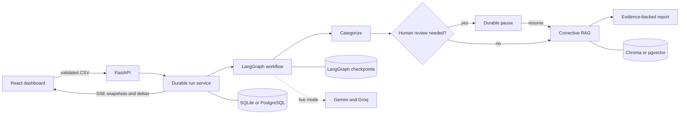

# SmartWealth

SmartWealth is a local-first, human-supervised financial audit workspace for
classifying business ledger transactions and producing evidence-backed draft
tax-treatment reports.

It combines a LangGraph workflow, corrective retrieval-augmented generation
(CRAG), durable run state, and human review. When evidence or model confidence
is insufficient, the system pauses or abstains instead of silently presenting
an unsupported deduction.

> [!IMPORTANT]
> SmartWealth produces a draft for accountant review. It is not tax advice, a
> filed return, or a substitute for verifying current law and transaction facts.

## Highlights

- **Validated ledger intake:** Papa Parse-powered CSV validation, a ten-row
  preview, row-specific errors, and one-megabyte/500-row limits.
- **Human-supervised categorization:** Low-confidence transactions pause the
  workflow for an explicit category decision.
- **Evidence-backed outcomes:** Results distinguish deductible,
  non-deductible, depreciable, partially deductible, and undetermined
  treatments. Positive outcomes require complete evidence provenance.
- **Corrective RAG:** Legal retrieval, document grading, query rewriting,
  bounded concurrency, and category-rule caching are integrated into the main
  workflow.
- **Durable lifecycle:** Queued, running, waiting, resumed, failed, cancelled,
  and completed states are stored independently from graph checkpoints.
- **Live progress:** Server-sent events deliver snapshots and deltas with
  bounded reconnect behavior.
- **Auditability:** A durable visual timeline and hash-chained human-override
  history record what changed, who changed it, and the downstream impact.
- **Evidence inspection:** The UI exposes corpus version, source document,
  section, page, chunk, retrieval score, passage, reasoning, and support status.
- **Measured evaluation:** The dashboard separates a historical baseline from a
  controlled fixture and shows confusion matrices, abstention coverage,
  retrieval faithfulness, latency, and provider cost.
- **Resilience controls:** Provider timeouts, jittered retry, circuit breaking,
  call/cost budgets, deterministic offline fallback, and bounded workers.
- **Operational visibility:** Structured logs, request/run/provider correlation,
  Prometheus metrics, liveness, readiness, backup/restore, and corpus rollback
  tooling.

Receipt upload and OCR are intentionally outside the current product boundary.
The application accepts ledger CSV files only.

## How it works



The run record is the authoritative lifecycle source. LangGraph checkpoints
preserve workflow position, while the run store owns status, idempotency,
progress, retention, timeline events, provider usage, and human-override audit
records.

## Technology

| Area | Stack |
|---|---|
| Frontend | React 19, Vite 8, Tailwind CSS 4, Zustand, Papa Parse |
| API | FastAPI, Pydantic, Uvicorn |
| Workflow | LangGraph with interrupt/resume checkpoints |
| AI providers | Google Gemini with Groq fallback |
| Retrieval | Hugging Face embeddings, Chroma for local use, pgvector configuration for managed deployment |
| Persistence | SQLite locally; PostgreSQL run/checkpoint support for managed environments |
| Testing | Pytest, Vitest, Testing Library, axe-core, oxlint |
| Operations | Structured JSON logging, Prometheus metrics, SBOMs, GitHub Actions |

## Quick start: deterministic offline mode

Offline mode exercises the complete application workflow without provider
credentials or a vector index. Commands below use Git Bash.

### Prerequisites

- Python 3.11 or newer
- Node.js 22
- npm
- Git Bash, curl, and a modern browser

The current repository has been validated with Python 3.14.3.

### Install

After cloning this repository:

```bash
cd smart-wealth

python -m venv .venv
source .venv/Scripts/activate
python -m pip install --upgrade pip
python -m pip install -r backend/requirements.txt
npm ci --prefix frontend
```

On Linux or macOS, activate the environment with
`source .venv/bin/activate`.

### Start the backend

```bash
source .venv/Scripts/activate
export OFFLINE_DEMO_MODE=true
export RUN_STORAGE_MODE=session
export ENVIRONMENT=development
export API_DELAY_SECONDS=0

python -m backend.app.preflight
python -m backend.app.main
```

### Start the frontend

In a second Git Bash terminal:

```bash
cd frontend
npm run dev
```

Open `http://localhost:5173`, accept the processing notice, and upload
`data/demo/smartwealth_demo.csv`. The synthetic dataset contains 24
transactions and one deliberate ambiguous row.

## Input format

Required CSV columns:

```csv
date,merchant,amount,description
2025-01-01,Office Depot,150.00,Printer paper
```

- Dates must use `YYYY-MM-DD`.
- Amounts must be greater than zero.
- Merchant is required.
- Merchant and description are limited to 500 characters.
- `transaction_id` and `category` may exist in demo data but are not trusted
  as client decisions; the server creates transaction IDs and performs its own
  categorization.

## Verification

```bash
source .venv/Scripts/activate
python -m pytest -q backend/tests
python -m compileall -q backend eval scripts data

cd frontend
npm test -- --run
npm run lint
npm run build
npm audit
```

The repository currently verifies 79 backend tests and 21 frontend tests. The
complete browser, API, recovery, security, resilience, data, evaluation, and
operations acceptance procedure is in the
[Manual Acceptance Test Guide](./docs/manual_testing_guide.md).

## Evaluation

Regenerate the provider-free evaluation dashboard:

```bash
python -m eval.run_mock_baseline
```

Run the reproducible synthetic evaluation harness:

```bash
export OFFLINE_DEMO_MODE=true
python -m eval.run_eval --dataset-dir data/synthetic --report-dir eval/manual-run --repeats 2
```

Controlled-fixture measurements validate the evaluation pipeline; they are not
claims about live-model or tax-law accuracy. A live labeled benchmark requires
configured providers, a verified corpus, and qualified domain review.

## Live-provider mode

Live mode may send transaction text and retrieved tax passages to configured
providers and may incur cost. Review provider retention, region, and processing
terms before enabling it.

1. Copy `.env.example` to an untracked `.env`.
2. Supply `GOOGLE_API_KEY` and `GROQ_API_KEY`.
3. Place approved source PDFs under the configured PDF directory.
4. Build the immutable vector release with
   `python -m backend.app.rag.ingest`.
5. Run `python -m backend.app.preflight --env-file .env`.

Never commit provider credentials or real client financial data.

## API and operational endpoints

| Method | Endpoint | Purpose |
|---|---|---|
| `POST` | `/api/run` | Start an idempotent audit |
| `GET` | `/api/runs/{run_id}` | Read authoritative run state |
| `GET` | `/api/runs/{run_id}/events` | Stream state snapshots and deltas |
| `GET` | `/api/clarifications/{run_id}` | Read pending human review |
| `POST` | `/api/resume/{run_id}` | Resume with validated answers |
| `GET` | `/api/runs/{run_id}/audit` | Read the human-override audit chain |
| `POST` | `/api/runs/{run_id}/cancel` | Cancel active work |
| `DELETE` | `/api/runs/{run_id}` | Delete a terminal run |
| `GET` | `/api/evaluation/summary` | Read dashboard evaluation evidence |
| `GET` | `/health/live` | Process liveness |
| `GET` | `/health/ready` | Dependency-aware readiness |
| `GET` | `/metrics` | Prometheus-format metrics |

Start and resume requests require an `Idempotency-Key` header.

## Security and deployment boundary

This build intentionally has no login or API credential. It uses one
`local-workspace` namespace, and run IDs are workflow identifiers rather than
authorization. Bind it only to localhost or a trusted single-workspace network.

The application still enforces restricted hosts and origins, request/body/row
limits, strict schemas, server-generated IDs, prompt-data delimiting, safe
errors, correlation IDs, retention, scoped deletion, and guarded vector-index
replacement.

A public or multi-user deployment must add real identity, tenant authorization,
TLS termination, managed secrets, and verified infrastructure controls before
exposure. PostgreSQL and pgvector integration paths exist, but no hosted
deployment is claimed by this repository.

## Documentation

- [Architecture](./docs/architecture.md)
- [Security and privacy](./docs/SECURITY_AND_PRIVACY.md)
- [Security reporting](./SECURITY.md)
- [Contributing](./CONTRIBUTING.md)
- [Manual acceptance testing](./docs/manual_testing_guide.md)
- [Operations runbook](./docs/operations.md)
- [Deterministic demo runbook](./docs/demo_runbook.md)
- [Architecture decisions](./docs/adr/)

## Known boundaries

- Ledger CSV processing only; no receipt upload or OCR.
- Offline evidence validates workflow behavior, not legal correctness.
- Live provider availability and output quality depend on external services.
- Tax-law and corpus completeness require qualified review.
- The local SQLite/Chroma configuration is not a multi-user deployment.
- Container packaging is intentionally deferred until a hosting target is
  selected.

## License

No open-source license has been selected. Add an owner-approved license before
representing the repository as open source or accepting external reuse.
