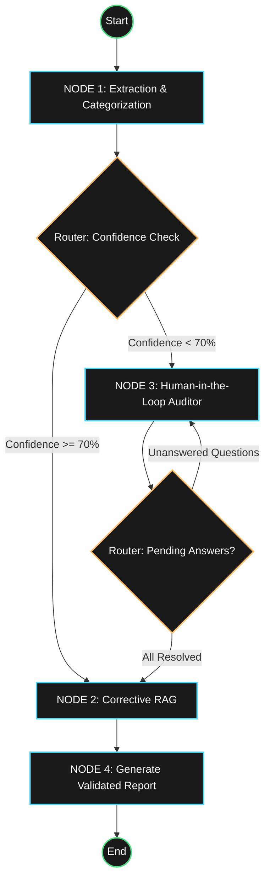
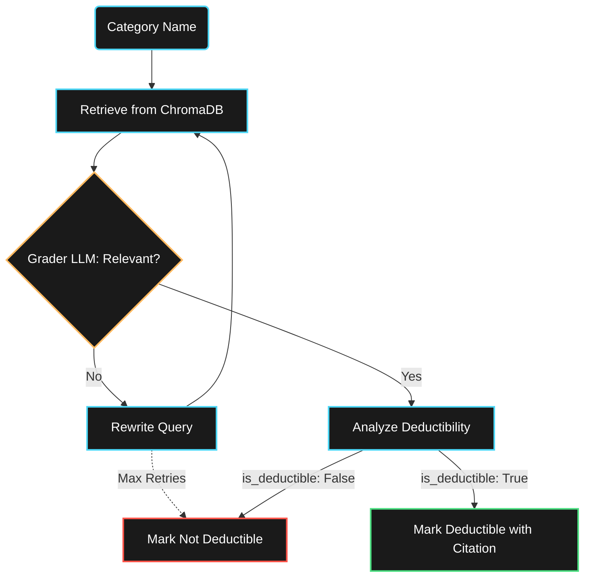

# SmartWealth Architecture

SmartWealth is built on an **Agentic State Machine** powered by LangGraph. It is designed to evaluate raw financial transactions against actual legal corpora (like the Indian Income Tax Act), preventing AI hallucinations using Corrective RAG, and pausing for human intervention on ambiguous edges.

## High-Level Graph Architecture

## Corrective RAG (CRAG) Flow

The CRAG node is the hallucination guardrail. It prevents the AI from approving a tax deduction unless it can physically cite a relevant section of the tax law.

## Data Persistence & State

1. **Graph checkpoint:** LangGraph checkpoints `AuditState` at node
   boundaries, allowing the auditor interrupt to survive a process restart.
2. **Authoritative run store:** A separate optimistic-locked run record owns
   queued/running/waiting/completed/failed/cancelled lifecycle, progress,
   retention, idempotency, provider budget, and safe errors.
3. **Durable evidence events:** Lifecycle/stage events and hash-chained human
   overrides are committed with run mutations. The current SSE stream delivers
   those events to the visual timeline and audit trail.
4. **Versioned evidence:** Legal results carry corpus, document, section, page,
   chunk, passage, and retrieval score into the evidence drawer and report.
5. **Optimized batching:** CRAG evaluates each unique category once, then
   applies transaction-specific amount, unresolved, and review safeguards.

## Access boundary

The local single-workspace build has no login or API credential and uses one trusted
`local-workspace` namespace. Opaque run IDs scope workflow operations but are
not authorization. Restricted hosts/origins, validation, rate/body/concurrency
limits, provider budgets, safe errors, and scoped deletion remain active. A
hosted multi-user deployment requires real identity and tenant authorization.
