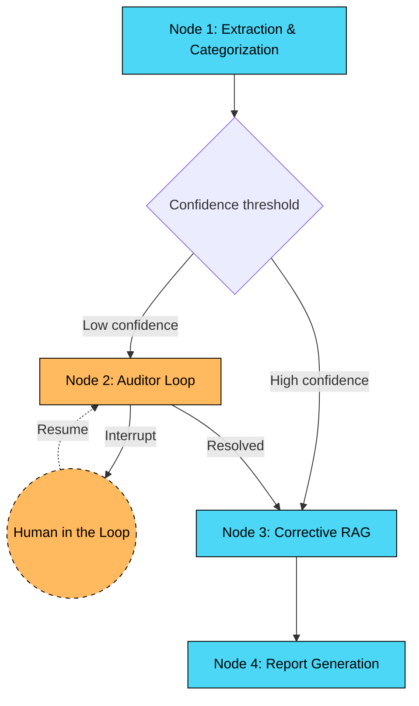

# SmartWealth Architecture

SmartWealth uses a LangGraph state machine with four core nodes. The state is maintained in a SQLite checkpointer database.

## Node Details

1. **Extraction (Node 1)**
   - Parses raw CSV transactions.
   - LLM categorizes transactions into 8 valid Indian business categories based on merchant name.
   - Assigns a confidence score. If `< 0.70`, the transaction is flagged for human review.

2. **Auditor Loop (Node 2)**
   - Receives low-confidence categorization results.
   - Pauses the LangGraph execution (`interrupt()`) and persists the checkpoint.
   - Resumes with strict category answers and records a hash-chained override.

3. **Corrective RAG (Node 3)**
   - **Optimization:** Groups transactions by category to run the RAG lookup only once per unique category.
   - Retrieves relevant sections from the Indian Income Tax Act.
   - Grades documents for relevance. If relevant, an LLM analyzes the passage to determine deductibility and cites the section.
   - If not relevant, rewrites the query and retries. If all retries fail, flags as "undetermined".

4. **Report (Node 4)**
   - Finalizes the audit.
   - Validates that every deducted expense has a verified tax citation.
   - Summarizes total deductibles and unresolved flags.
